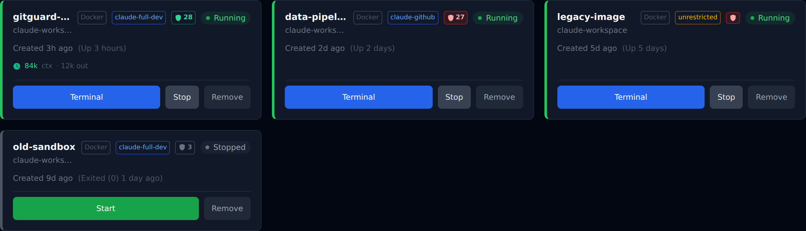
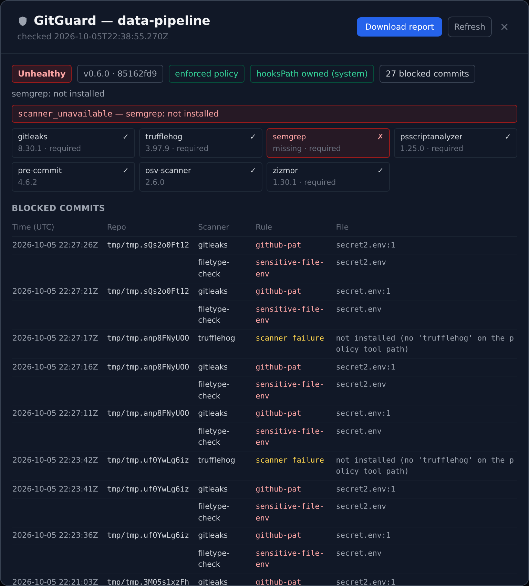

# GitGuard indicator

[GitGuard](https://github.com/CyberFarFaN/GitGuard) is a pre-commit security gate
(gitleaks, TruffleHog, Semgrep, PSScriptAnalyzer, zizmor). When the workspace image
installs it in **enforced mode**, every `git commit` inside an instance is scanned
and blocked on findings, missing scanners or broken tools. This feature shows that
gate's state per instance in the dashboard.

| Badge | Meaning |
|---|---|
| green shield | GitGuard ran, exit 0, `healthy: true` |
| red shield | GitGuard is not installed in the image, or reports unhealthy: a required scanner missing or broken, `core.hooksPath` not GitGuard's, policy rejected, or output that is not a valid GitGuard document |
| grey shield | instance stopped, not checked yet, or Docker could not reach it |
| number | commits GitGuard has blocked in this instance (from its event log) |

Clicking the badge opens a panel with GitGuard's status (version, scanners, hooksPath
ownership, problems), the blocked commits (time, repo, scanner, rule, file), and a
**Download report** button (admin) that scans every repo under `/workspace` and saves
GitGuard's HTML report.

## How the manager gets the data — and why this way

The manager already talks to instances three ways:

| Channel | Direction | Fit |
|---|---|---|
| `cm-notify` → `POST /api/instances/:id/event` | container → manager, **auth-exempt** | Rejected. A new message type here would let any container push arbitrary "GitGuard" data at the manager unprompted, and widen the only endpoint containers can call without auth. |
| Docker event stream | Docker → manager | Lifecycle only; carries no application data. |
| Docker exec API (`execInContainer`, used by idle-stop) | manager → container, **pull** | **Chosen.** No new listener, no new auth exemption, no new container capability. The manager decides when to ask and what to run. |

So the manager runs GitGuard's own versioned CLI over Docker exec:

- `gitguard status --json` (schema `gitguard.status/v1`): every `GITGUARD_POLL_INTERVAL_SECONDS` (default 120) per running instance, cached for the instance list. A change is broadcast as `{type:'gitguard'}` and the dashboard refetches.
- `gitguard events --json --limit 100` (`gitguard.events/v1`): on opening the panel.
- `gitguard report --root /workspace --output <random path> --json`, then `cat` of that file: on the admin's click.

## Threat model: the container is hostile

The agent in a container controls everything the manager reads from it: the
`gitguard` binary, its output, the report file. And a manager XSS is root on the
host via the Docker socket. So:

- **Bounded reads.** `execCapture` caps stdout (1 MiB JSON, 20 MiB report), stderr
  (64 KiB) and time (60 s status, 10 min report).
- **Allow-list parsing.** `server/gitguard.js` `parseStatus` / `parseEvents` /
  `parseReportResult` check the `schema` id, then copy only known fields, with fixed
  types and length caps, into fresh objects. Identifiers must match `[A-Za-z0-9._:/-]`,
  timestamps must be ISO-8601 UTC, and enums fall back to safe values. Unknown fields
  (e.g. a `value` someone adds to a finding) are dropped, so **secret values cannot
  reach the API, the database or the UI**, even from a malicious container.
- **Green has to be earned.** A forged `"healthy": true` with a non-zero exit code is red.
- **Text only in the UI.** React renders every value as text. GitGuard components
  use no `dangerouslySetInnerHTML`, `innerHTML`, `srcdoc` or iframes (enforced by a
  test).
- **The report never renders in the manager's origin.** It is generated at an
  unpredictable path, read back with `cat`, held server-side behind a single-use
  random token (10 min TTL), and served with `Content-Type: application/octet-stream`,
  `Content-Disposition: attachment`, `Content-Security-Policy: sandbox; default-src
  'none'`, `X-Content-Type-Options: nosniff`, `Cache-Control: no-store`. The client
  fetches it as an opaque blob and saves it. It never opens it.
- **Nothing is auth-exempt.** All routes sit behind device auth. Report generation and
  download are admin-only. No GitGuard data is stored in SQLite.

## Config

| Env | Default | |
|---|---|---|
| `GITGUARD_POLL_INTERVAL_SECONDS` | `120` | `0` disables the badge, the panel API and the polling (e.g. images without GitGuard). |

## Tests

`tests/13-gitguard.test.js` covers several layers:
- pure tests over **real** GitGuard output captured from a running instance (`tests/fixtures/gitguard/`: healthy, semgrep removed, event log)
- hostile-input cases: markup, oversized strings and arrays, type confusion, `__proto__`, smuggled secret fields, forged health
- badge classification
- the HTTP contract via `fastify.inject`: admin gate, download headers, single-use tokens, feature off
- a live section that runs under `tests/run-all.js`
